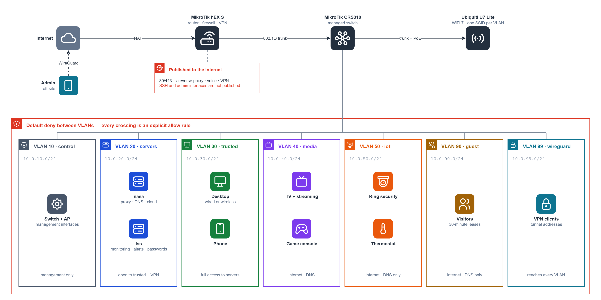
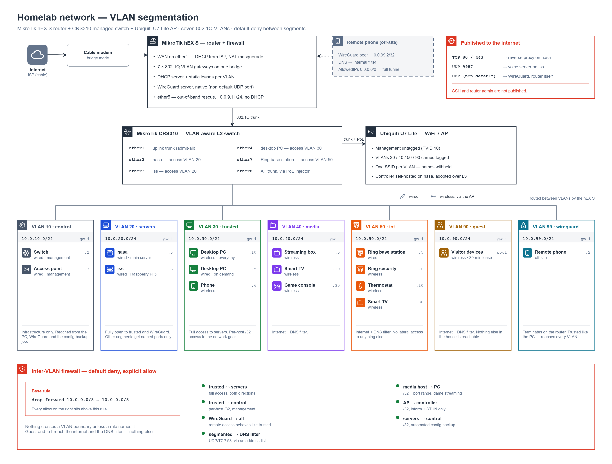
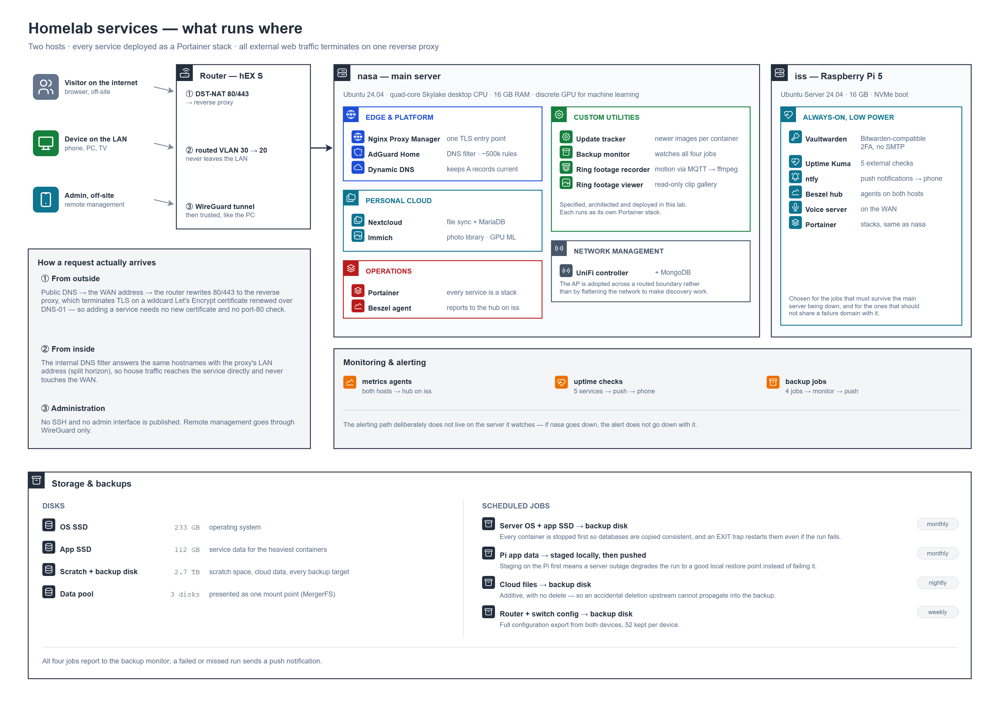

# Homelab: Segmented Network and Self-Hosted Services

A two-host homelab behind a MikroTik router and managed switch, split into seven VLANs with a default-deny firewall between them. It runs a reverse proxy with automated TLS, house-wide DNS filtering, personal-cloud services, independent monitoring and scheduled backups, all as Docker containers managed in Portainer. Remote administration goes through WireGuard only.

> **What's withheld:** the public IP address, domain name, hardware MAC addresses, wireless network names, other device makes on the IoT segment, and all credentials. The private `10.0.x.0/24` subnets are shown on purpose: they aren't reachable from outside, and they're what makes the segmentation readable.

**Status:** in daily use.



## Network



1. **Edge:** the cable modem runs in bridge mode, so the MikroTik hEX S holds the public address. The ISP assigns that address over DHCP, so a dynamic DNS updater keeps the public A records pointed at it, and published services follow it when it changes. The router handles NAT, DHCP for every VLAN, inter-VLAN routing and the WireGuard server. Port `ether5` sits outside the bridge as an out-of-band rescue port (manual IP only, no DHCP), so a bad bridge or VLAN change can't lock out management.
2. **Switching:** a single 802.1Q trunk runs to a MikroTik CRS310. The servers, desktop and Ring base station use access ports; the access point uses a trunk port through a PoE injector, because the switch has no PoE output.
3. **Wireless:** a Ubiquiti U7 Lite broadcasts one SSID per VLAN, with its own management traffic untagged on VLAN 10. The UniFi controller runs on the main server in VLAN 20, so the AP finds it through DHCP option 43 instead of Layer 2 discovery. That keeps the controller and AP on separate routed segments instead of flattening the network to make discovery work.
4. **Segments:**

   | VLAN | Name | Holds | Policy |
   |---|---|---|---|
   | 10 | control | switch, AP | Infrastructure only; reached by the desktop, WireGuard and the config-backup job |
   | 20 | servers | both servers | Fully open to trusted and WireGuard; other segments get named ports only |
   | 30 | trusted | desktop, phone | Full access to servers; per-host access to the network gear |
   | 40 | media | TV, streaming box, console | Internet and DNS filter |
   | 50 | iot | Ring security, thermostat, TV | Internet and DNS filter only |
   | 90 | guest | visitors | Internet and DNS filter only |
   | 99 | wireguard | remote phone | Reaches every VLAN, like trusted |

5. **Firewall:** the forward chain ends with `drop 10.0.0.0/8 → 10.0.0.0/8`, and every inter-VLAN allow sits above it. Each allow is scoped to the smallest set that actually reduces exposure. Media → desktop (game streaming) is a single `/32` on a fixed port range, because it is the only path from an untrusted segment into trusted.
6. **Router hardening:** FTP, Telnet, the web UI and the API services are disabled. SSH and Winbox are bound at the service level to the trusted, management and WireGuard subnets, so they won't answer on the WAN even if a firewall edit goes wrong. Unsolicited WAN input is dropped.
7. **DNS:** every VLAN gets the internal DNS filter first and a public resolver second. The fallback is there because the monthly server backup stops every container, the DNS filter included.

## Services



1. **Inbound requests:** from outside, the router forwards 80/443 to Nginx Proxy Manager, which terminates TLS on a wildcard Let's Encrypt certificate renewed through a DNS-01 challenge, so a new service needs no new certificate and no port-80 check. From inside, AdGuard Home answers the same hostnames with the proxy's LAN address (split-horizon DNS), so house traffic never leaves the LAN. No SSH or admin interface is published.
2. **nasa (main server):** Ubuntu 24.04 running the reverse proxy, DNS filter, dynamic DNS updater, the photo library (Immich), file sync (Nextcloud), the UniFi controller and the custom utilities. A discrete NVIDIA GPU is passed through to the photo library for its machine-learning features.
3. **iss (Raspberry Pi 5):** the always-on services that shouldn't depend on the main server: the Vaultwarden password manager, Uptime Kuma, ntfy push notifications, the Beszel metrics hub and a voice server. Monitoring lives here on purpose, so an outage on nasa can still raise an alert.
4. **Custom utilities:** a container update tracker, a backup monitor, and a motion-triggered recorder and viewer for Ring security footage. The requirements, architecture and deployment (container configuration, environment variables, storage mounts, network integration) were done in this lab.
5. **Storage:** three data disks are pooled into one mount point with MergerFS, with an SSD for application data and a separate disk for scratch space and every backup target.

## Backups

| Job | Schedule | Notes |
|---|---|---|
| Server OS + app SSD → backup disk | Monthly | Stops every container first so databases are copied in a consistent state; an `EXIT` trap restarts them in dependency order even if the run fails |
| Pi app data → staged on the Pi, then pushed to the server | Monthly | If the server is down, the run still leaves a good local restore point instead of failing |
| Cloud files → backup disk | Nightly | Additive, with no `--delete`, so an accidental deletion upstream can't spread into the backup |
| Router + switch configuration export | Weekly | Pulled over SSH from both devices; 52 kept per device |

All four jobs report to the backup monitor, and a failed or missed run sends a push notification.

## Repository contents

```
docs/homelab-overview.png   one-page overview
docs/homelab-network.png    network and VLAN diagram
docs/homelab-services.png   service, monitoring and backup diagram
```

Icons: [Tabler Icons](https://github.com/tabler/tabler-icons) (MIT license).

## Lessons

- **Re-check recovery paths after any hardening pass.** Tightening the router's management access left out the rescue port's subnet. A rescue path only gets used in an emergency, so a break like that stays silent until you need it. After tightening any allowlist, binding or firewall rule, walk the recovery documentation and test each path. WireGuard, for example, is tested over cellular after any firewall change.
- **"It works" doesn't prove traffic takes the path you designed.** Game streaming worked across a firewall that should have blocked it, because it was relaying through the vendor's cloud. Reading the router's connection table showed the real path in one command.
- **Refer to firewall rules by comment, never by position.** Every new rule above the default-deny renumbers everything below it. Documentation, undo commands and cross-references all use comment matches, which survive renumbering.
- **Treat an empty match as a failed command.** In RouterOS, `set` or `remove` on a `find` that matches nothing succeeds silently, and the worst case is an undo command that does nothing while you think you rolled back. Print the match before acting on it.
